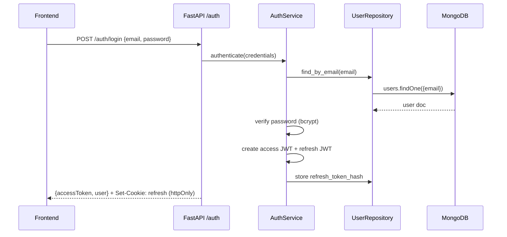
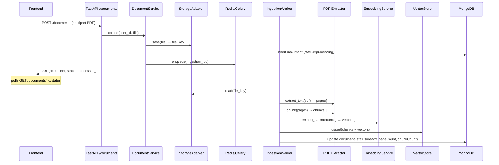
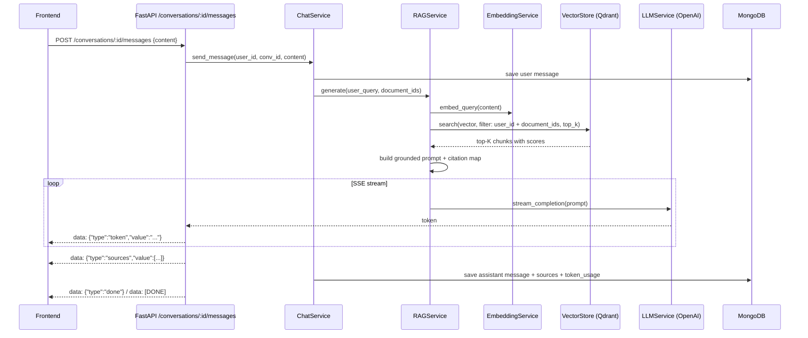
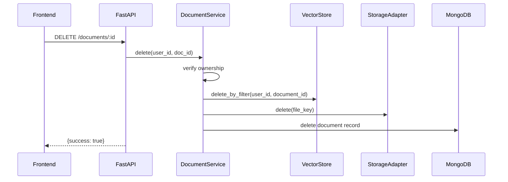

# AI PDF Knowledge Assistant — Backend Architecture

FastAPI backend for the AI PDF Knowledge Assistant. Designed to integrate with the
existing Next.js frontend (`client/`) which expects `/api/v1` endpoints, JWT auth
with httpOnly refresh cookies, and SSE streaming for chat.

---

## 1. Recommended Folder Structure

```text
server/
├── app/
│   ├── main.py                      # FastAPI app factory, lifespan, CORS
│   ├── api/
│   │   ├── deps.py                  # DI: current user, DB session, services
│   │   └── v1/
│   │       ├── router.py            # mounts all v1 routers under /api/v1
│   │       ├── auth.py              # register, login, refresh, logout, me
│   │       ├── documents.py         # upload, list, get, status, delete
│   │       ├── conversations.py     # CRUD + message list
│   │       └── chat.py              # POST message → SSE stream (RAG)
│   ├── core/
│   │   ├── config.py                # Pydantic Settings (env validation)
│   │   ├── security.py              # JWT create/verify, password hashing
│   │   ├── exceptions.py            # AppException + handlers
│   │   └── logging.py               # structured logging setup
│   ├── models/                      # MongoDB document models (Beanie/Motor)
│   │   ├── user.py
│   │   ├── document.py
│   │   ├── conversation.py
│   │   └── message.py
│   ├── schemas/                     # Pydantic request/response DTOs
│   │   ├── common.py                # ApiResponse, Paginated, ApiError
│   │   ├── auth.py
│   │   ├── document.py
│   │   ├── conversation.py
│   │   └── chat.py
│   ├── repositories/                # data access only (no business logic)
│   │   ├── user_repo.py
│   │   ├── document_repo.py
│   │   ├── conversation_repo.py
│   │   └── message_repo.py
│   ├── services/                    # business logic orchestration
│   │   ├── auth_service.py
│   │   ├── document_service.py
│   │   ├── ingestion_service.py     # PDF pipeline orchestrator
│   │   ├── chat_service.py
│   │   └── rag_service.py           # retrieval + prompt + stream
│   ├── ai/
│   │   ├── openai_client.py         # OpenAI SDK wrapper
│   │   ├── embedding_service.py     # batch embed texts
│   │   ├── llm_service.py           # chat completion (streaming)
│   │   └── prompts.py               # system/user prompt templates
│   ├── pdf/
│   │   ├── extractor.py             # text extraction (PyMuPDF/pdfplumber)
│   │   └── chunker.py               # token-aware splitting + overlap
│   ├── vector/
│   │   ├── qdrant_client.py         # connection + collection management
│   │   └── vector_store.py          # upsert, search, delete by filter
│   ├── storage/
│   │   ├── base.py                  # StorageAdapter interface
│   │   └── local.py                 # local disk (dev); swap for S3 in prod
│   ├── workers/
│   │   ├── celery_app.py            # Celery/ARQ worker config
│   │   └── ingestion_worker.py      # async: parse → chunk → embed → upsert
│   ├── middleware/
│   │   └── rate_limit.py
│   └── utils/
│       ├── pagination.py
│       └── ids.py
├── tests/
│   ├── unit/
│   ├── integration/
│   └── conftest.py
├── uploads/                         # local PDF storage (gitignored)
├── .env.example
├── pyproject.toml                   # uv/poetry deps + scripts
├── Dockerfile
└── docker-compose.yml               # api, mongo, qdrant, redis, worker
```

---

## 2. System Architecture

```text
┌─────────────────────────────────────────────────────────────────────────┐
│                         Next.js Frontend (client/)                      │
│   Axios (JWT Bearer) + httpOnly refresh cookie + SSE fetch stream       │
└──────────────────────────────────┬──────────────────────────────────────┘
                                   │ /api/v1/*
                                   ▼
┌─────────────────────────────────────────────────────────────────────────┐
│                         FastAPI Application                             │
│  ┌──────────┐  ┌────────────┐  ┌─────────────┐  ┌──────────────────┐  │
│  │ API v1   │→ │ Middleware │→ │  Services   │→ │  Repositories    │  │
│  │ Routers  │  │ Auth/CORS  │  │ (business)  │  │ (data access)    │  │
│  └──────────┘  └────────────┘  └──────┬──────┘  └────────┬─────────┘  │
│                                       │                   │             │
│                    ┌──────────────────┼───────────────────┤             │
│                    ▼                  ▼                   ▼             │
│              ┌──────────┐    ┌────────────┐      ┌────────────┐        │
│              │ AI Layer │    │ PDF Layer  │      │  Storage   │        │
│              │ OpenAI   │    │ Extract +  │      │  Adapter   │        │
│              │ Embed+LLM│    │ Chunk      │      │ (local/S3) │        │
│              └────┬─────┘    └─────┬──────┘      └────────────┘        │
│                   │                │                                     │
│                   ▼                ▼                                     │
│              ┌──────────┐    ┌────────────┐                            │
│              │  Qdrant  │    │  Worker    │  ← Celery/ARQ + Redis       │
│              │  Vectors │    │  (async)   │                            │
│              └──────────┘    └────────────┘                            │
└──────────────────────────────────┬──────────────────────────────────────┘
                                   ▼
                            ┌────────────┐
                            │  MongoDB   │
                            │  (Motor/   │
                            │   Beanie)  │
                            └────────────┘
```

### Layer responsibilities

| Layer | Role |
|-------|------|
| **API (routers)** | HTTP contract, request validation, auth dependency injection, response shaping. No business logic. |
| **Services** | Orchestrate workflows: auth, upload, ingestion, RAG chat, deletion cascades. |
| **Repositories** | CRUD against MongoDB. Query building, indexes, ownership filters. No OpenAI/Qdrant calls. |
| **AI / PDF / Vector** | Specialized adapters for external systems. Stateless, testable in isolation. |
| **Workers** | Long-running ingestion jobs decoupled from HTTP request lifecycle. |

### Key design decisions

- **Async ingestion**: `POST /documents` returns immediately with `status: processing`. A background worker runs the full pipeline and updates status to `ready` or `failed`.
- **Multi-tenant isolation**: every Mongo document and Qdrant point carries `user_id`. All queries are scoped to the authenticated user.
- **Frontend contract**: responses use `{ success, data }` envelope; Mongo `_id` serialized as string; SSE events match the frontend's `StreamEvent` types.
- **JWT dual-token**: short-lived access token (Bearer header) + long-lived refresh token (httpOnly cookie), matching the frontend axios interceptor.
- **Stateless API**: horizontally scalable behind a load balancer; workers scale independently.

---

## 3. Request Flow Diagrams

### 3.1 Authentication — Login



### 3.2 PDF Upload & Ingestion



### 3.3 Chat with RAG (SSE Stream)



### 3.4 Document Deletion (Cascade)



---

## 4. Database Collections / Schemas

MongoDB via Motor + Beanie ODM. All collections use `_id: ObjectId` (serialized as
string in API responses to match the frontend).

### 4.1 `users`

| Field | Type | Constraints | Notes |
|-------|------|-------------|-------|
| `_id` | ObjectId | PK | |
| `name` | string | required | |
| `email` | string | required, unique, indexed, lowercase | |
| `password_hash` | string | required | bcrypt; never returned |
| `role` | string | enum: `user`, `admin` | default `user` |
| `refresh_token_hash` | string | optional | for rotation/revocation |
| `created_at` | datetime | auto | |
| `updated_at` | datetime | auto | |

**Indexes**: `{ email: 1 }` unique

### 4.2 `documents`

| Field | Type | Constraints | Notes |
|-------|------|-------------|-------|
| `_id` | ObjectId | PK | also used in Qdrant filter |
| `user_id` | ObjectId → users | required, indexed | ownership |
| `title` | string | required | original filename or user-edited |
| `file_key` | string | required | storage path / S3 key |
| `mime_type` | string | required | `application/pdf` |
| `size_bytes` | int | required | |
| `page_count` | int | optional | set after extraction |
| `chunk_count` | int | optional | set after embedding |
| `status` | string | enum: `processing`, `ready`, `failed` | indexed |
| `error` | string | optional | failure reason |
| `created_at` | datetime | auto | |
| `updated_at` | datetime | auto | |

**Indexes**: `{ user_id: 1, created_at: -1 }`, `{ user_id: 1, status: 1 }`

### 4.3 `conversations`

| Field | Type | Constraints | Notes |
|-------|------|-------------|-------|
| `_id` | ObjectId | PK | |
| `user_id` | ObjectId → users | required, indexed | |
| `title` | string | required | auto from first message |
| `document_ids` | [ObjectId → documents] | required | scope of chat |
| `last_message_at` | datetime | indexed | for history sorting |
| `created_at` | datetime | auto | |
| `updated_at` | datetime | auto | |

**Indexes**: `{ user_id: 1, last_message_at: -1 }`

### 4.4 `messages`

| Field | Type | Constraints | Notes |
|-------|------|-------------|-------|
| `_id` | ObjectId | PK | |
| `conversation_id` | ObjectId → conversations | required, indexed | |
| `role` | string | enum: `user`, `assistant` | |
| `content` | string | required | |
| `sources` | array | optional | citation objects (assistant only) |
| `sources[].chunk_id` | string | | Qdrant point ID |
| `sources[].document_id` | ObjectId | | |
| `sources[].title` | string | | document title |
| `sources[].page` | int | | source page number |
| `sources[].score` | float | | similarity score |
| `sources[].snippet` | string | | excerpt text |
| `token_usage` | object | optional | `{ prompt, completion }` |
| `created_at` | datetime | auto, indexed | |

**Indexes**: `{ conversation_id: 1, created_at: 1 }`

---

## 5. API Endpoint Design

Base: `/api/v1` — versioned, RESTful. Response envelope:

```json
{ "success": true, "data": { ... } }
{ "success": false, "error": { "code": "...", "message": "...", "details": {} } }
```

### 5.1 Auth

| Method | Endpoint | Auth | Purpose |
|--------|----------|------|---------|
| POST | `/auth/register` | Public | Create account → issue tokens |
| POST | `/auth/login` | Public | Authenticate → issue tokens |
| POST | `/auth/refresh` | Cookie | Rotate access token from refresh cookie |
| POST | `/auth/logout` | JWT | Revoke refresh token, clear cookie |
| GET | `/auth/me` | JWT | Current user profile |

**Login/Register response** (matches frontend `AuthResponse`):

```json
{
  "success": true,
  "data": {
    "accessToken": "eyJ...",
    "user": { "id": "...", "name": "...", "email": "..." }
  }
}
```

Refresh sets `Set-Cookie: refresh_token=...; HttpOnly; Secure; SameSite=Lax`.

### 5.2 Documents

| Method | Endpoint | Auth | Purpose |
|--------|----------|------|---------|
| POST | `/documents` | JWT | Upload PDF (multipart `file`) → enqueue ingestion |
| GET | `/documents` | JWT | List user's documents (paginated, filter by status) |
| GET | `/documents/{id}` | JWT | Document details |
| GET | `/documents/{id}/status` | JWT | Lightweight status poll endpoint |
| DELETE | `/documents/{id}` | JWT | Delete doc + Qdrant vectors + stored file |

**Upload response** (immediate, `status: processing`):

```json
{
  "success": true,
  "data": {
    "_id": "...",
    "title": "report.pdf",
    "sizeBytes": 920500,
    "pageCount": null,
    "status": "processing",
    "createdAt": "2026-06-05T10:00:00Z"
  }
}
```

### 5.3 Conversations & Chat

| Method | Endpoint | Auth | Purpose |
|--------|----------|------|---------|
| POST | `/conversations` | JWT | Start conversation `{ documentIds, title? }` |
| GET | `/conversations` | JWT | List history (paginated, sorted by `lastMessageAt`) |
| GET | `/conversations/{id}` | JWT | Conversation + embedded messages |
| DELETE | `/conversations/{id}` | JWT | Delete conversation + messages |
| GET | `/conversations/{id}/messages` | JWT | Paginated message list |
| POST | `/conversations/{id}/messages` | JWT | Send message → **SSE stream** RAG answer |

**SSE event format** (matches frontend `StreamEvent`):

```
data: {"type":"token","value":"Based "}
data: {"type":"token","value":"on "}
data: {"type":"sources","value":[{"chunkId":"...","documentId":"...","title":"...","page":12,"score":0.91,"snippet":"..."}]}
data: {"type":"done"}
data: [DONE]
```

### 5.4 System

| Method | Endpoint | Auth | Purpose |
|--------|----------|------|---------|
| GET | `/health` | Public | Liveness/readiness (Mongo, Qdrant, Redis checks) |

### Cross-cutting conventions

- **Pagination**: `?page=1&limit=20&sort=-createdAt` → `{ items, page, limit, total }`
- **Ownership**: every `/{id}` route verifies resource belongs to `current_user`
- **Rate limiting**: stricter on `/auth/*` and chat endpoints
- **CORS**: allow frontend origin + `credentials: true` for refresh cookies

---

## 6. Service Responsibilities

| Service | Responsibilities |
|---------|-----------------|
| **AuthService** | Register, login, logout, token refresh, password hashing/verification, refresh token rotation and revocation. |
| **DocumentService** | Validate upload (PDF, size limit), persist file via storage adapter, create Mongo record, enqueue ingestion job, list/get/delete with ownership checks, cascade delete (vectors + file). |
| **IngestionService** | Orchestrate the full PDF pipeline: extract → chunk → embed → upsert to Qdrant → update document status. Called by the background worker, not directly by HTTP. |
| **ChatService** | Create/list/get/delete conversations. Persist user messages. Delegate answer generation to RAGService. Persist assistant messages with sources and token usage. Update `last_message_at`. |
| **RAGService** | Embed user query → Qdrant similarity search (filtered by user + document scope) → assemble grounded prompt with citation markers → stream LLM response → return source references. |

### AI sub-services

| Service | Responsibilities |
|---------|-----------------|
| **EmbeddingService** | Batch-embed text chunks and queries via OpenAI `text-embedding-3-small`. Handle rate limits and retries. |
| **LLMService** | Stream chat completions via OpenAI `gpt-4o-mini`. Yield tokens for SSE forwarding. Track token usage. |
| **PromptTemplates** | System prompt enforcing grounded answers, citation format, and "I don't know" behavior when context is insufficient. |

### PDF sub-services

| Service | Responsibilities |
|---------|-----------------|
| **PDFExtractor** | Extract text per page with metadata (page number, bounding context). Handle scanned PDFs gracefully (OCR optional, future). |
| **Chunker** | Token-aware splitting with configurable `chunk_size` and `chunk_overlap`. Preserve page attribution per chunk. |

---

## 7. Repository Responsibilities

Repositories contain **only** data access logic. No OpenAI, Qdrant, or file I/O.

| Repository | Methods | Notes |
|------------|---------|-------|
| **UserRepository** | `create`, `find_by_email`, `find_by_id`, `update_refresh_token`, `clear_refresh_token` | Email uniqueness enforced at DB level |
| **DocumentRepository** | `create`, `find_by_id`, `find_by_user`, `update_status`, `delete` | All queries scoped by `user_id` |
| **ConversationRepository** | `create`, `find_by_id`, `find_by_user` (paginated), `update_last_message_at`, `delete` | Sort by `last_message_at` desc |
| **MessageRepository** | `create`, `find_by_conversation` (paginated), `delete_by_conversation` | Ordered by `created_at` asc |

---

## 8. Qdrant Collection Design

### Collection: `pdf_chunks`

| Property | Value |
|----------|-------|
| **Vector size** | 1536 (for `text-embedding-3-small`) |
| **Distance metric** | Cosine |
| **Point ID** | `chunk_id` (UUID string) |

### Payload schema

| Field | Type | Indexed | Purpose |
|-------|------|---------|---------|
| `user_id` | string | yes (keyword) | multi-tenant isolation |
| `document_id` | string | yes (keyword) | scope retrieval to selected PDFs |
| `page` | int | no | citation page number |
| `chunk_index` | int | no | ordering within document |
| `text` | string | no | chunk content (returned in search for snippets) |

### Payload indexes

```text
user_id     → keyword index (mandatory filter on every query)
document_id → keyword index (filter to conversation's document scope)
```

### Operations

| Operation | When | Filter |
|-----------|------|--------|
| **Upsert** | After ingestion | N/A (batch insert) |
| **Search** | During RAG chat | `user_id` AND `document_id IN [...]` |
| **Delete** | Document deletion | `user_id` AND `document_id` |
| **Delete all** | User account deletion (future) | `user_id` |

### Search parameters

- `top_k`: 5 (configurable via `RAG_TOP_K`)
- `score_threshold`: 0.7 (configurable, prevents low-quality citations)
- Always pre-filter by `user_id` before vector search (security + relevance)

---

## 9. RAG Workflow

### Step-by-step

```text
1. RECEIVE user message in conversation (scoped to document_ids)
2. PERSIST user message to MongoDB
3. EMBED query via OpenAI Embedding API
4. SEARCH Qdrant:
     filter: user_id = current_user AND document_id IN conversation.document_ids
     limit: top_k (default 5)
     metric: cosine similarity
5. BUILD context block:
     for each retrieved chunk:
       format as [N] (Document Title, p.X): "chunk text"
       map N → source metadata (chunk_id, document_id, page, score, snippet)
6. ASSEMBLE prompt:
     system: "Answer ONLY from the provided context. Cite sources as [N]."
     user: context block + user question
7. STREAM LLM completion:
     yield tokens → SSE to frontend
8. EMIT sources event with citation array (matches frontend Source type)
9. PERSIST assistant message + sources + token_usage to MongoDB
10. UPDATE conversation.last_message_at
```

### Prompt strategy

- Instruct the model to cite using `[1]`, `[2]` markers matching the context block.
- If no chunks exceed the score threshold, respond with a honest "I couldn't find
  relevant information in the selected documents" message (no hallucination).
- Include document title and page in every source citation returned to the frontend.

### Error handling

| Failure | Behavior |
|---------|----------|
| Qdrant unavailable | SSE `error` event, HTTP 503 |
| OpenAI rate limit | Retry with backoff; SSE `error` if exhausted |
| No relevant chunks | Stream a grounded "no information found" response |
| Document still processing | Reject chat creation if any `document_id` is not `ready` |

---

## Environment Variables

See `.env.example` in this directory.

## Running with the Frontend

1. Start infrastructure: `docker compose up -d` (Mongo, Qdrant, Redis)
2. Start API: `uvicorn app.main:app --reload --port 5000`
3. Start worker: `celery -A app.workers.celery_app worker`
4. Set frontend `NEXT_PUBLIC_USE_MOCK=false` and `BACKEND_URL=http://localhost:5000`
